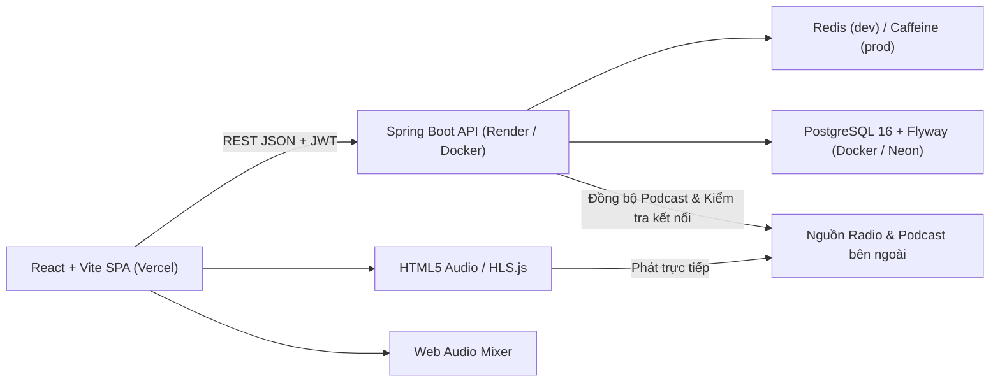
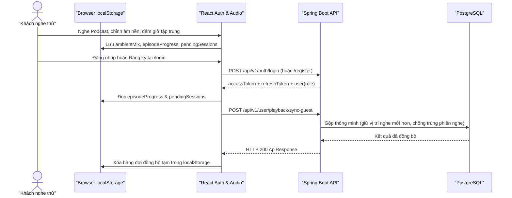

# Sola - Đặc tả Tính năng, Kiến trúc, Database Schema & API Contract

> Tài liệu tổng hợp toàn bộ quyết định sản phẩm, giao diện người dùng (UI/UX), kiến trúc hệ thống, cơ sở dữ liệu và API đã chốt cho dự án **Sola** (Góc nghe Radio, Podcast & Âm thanh tập trung hằng ngày).

---

## 1. Tổng quan Sản phẩm & Danh sách Tính năng đã chốt

### 1.1. Định hướng Giao diện & Trải nghiệm (UI/UX)
- **Phong cách chủ đạo:** **Soft-Bento kết hợp Liquid Glass Chrome**, tràn viền **100% toàn màn hình (Edge-to-Edge `100dvh`)**, không dùng khung viền xám bao ngoài.
  - **Light Mode:** Nền kem ấm `#F4F1EA`, thẻ trắng `#FFFFFF`, ô phụ `#F8F6F1`, chữ than chì `#1E1F24`, điểm nhấn vàng nắng `#F5C428`.
  - **Dark Mode:** Nền tối `#111217`, thẻ `#1A1C23`, ô phụ `#22252E`, chữ sáng `#F8FAFC`, điểm nhấn vàng `#FACC15`.
  - **Hiệu ứng kính mờ (`backdrop-filter`):** Chỉ áp dụng tinh tế trên thanh điều hướng nổi bên trái, nút chuyển Sáng/Tối và thanh trình phát thu gọn dưới đáy (`floatingDock`), có fallback nền đặc khi bật `prefers-reduced-transparency`.
- **Ngôn ngữ hiển thị:** Tiếng Việt gần gũi, nhẹ nhàng, có cảm xúc (loại bỏ hoàn toàn thuật ngữ kỹ thuật như `RSS`, `SSRF`, `Web Audio`, `Probe`, `Degraded`, `Workspace` khỏi giao diện người dùng cuối).
- **Tách biệt 2 khung giao diện (Dual-Shell Architecture):**
  1. **Public Shell (`/`, `/login`):** Chỉ gồm thanh Header tối giản (Logo `Sola`, nút Sáng/Tối, nút `Đăng nhập` / `Nghe thử`), không hiển thị thanh công cụ trái hay thanh tìm kiếm.
  2. **App Shell (`/studio`, `/discover`, `/dashboard`, `/admin`):** Gồm thanh icon nổi bên trái phân quyền theo vai trò + Header cố định bên trên (hiển thị Tiêu đề trang + câu dẫn nhẹ nhàng ở bên trái; Sáng/Tối + nút hành động ở bên phải) + Trình phát nhạc giữ kết nối xuyên suốt khi chuyển trang.

### 1.2. Tính năng theo từng Phân quyền

| Vai trò | Lưu trữ | Các tính năng chính đã chốt |
| :--- | :--- | :--- |
| **Khách (`GUEST`)** | `localStorage` trên trình duyệt | - Xem trang giới thiệu (`/`), nghe thử âm thanh trực tiếp ngay trên Hero.<br>- Vào **Phòng nghe (`/studio`)** không cần tài khoản: nghe các kênh tuyển chọn (`isFeatured = true`), trộn 3 lớp âm thanh nền (Mưa nhẹ, Quán cafe ấm, Âm nền dịu), dùng đồng hồ tập trung 25/50 phút, hẹn tắt êm khi ngủ (Sleep fade-out) và chế độ tĩnh lặng toàn màn hình (**Zen**).<br>- Duyệt và tìm kiếm kênh công khai, tập Podcast ở **Khám phá (`/discover`)**.<br>- Tự động giữ tiến độ nghe dở và cấu hình âm lượng để gộp lên tài khoản ngay khi đăng nhập/đăng ký. |
| **Thành viên (`USER`)** | PostgreSQL + Đồng bộ đa thiết bị | - Toàn bộ tính năng của `GUEST` kèm **Tự động gộp dữ liệu nghe thử (`Guest-to-User Sync`)** ngay sau khi đăng nhập.<br>- Mở khóa **Góc cá nhân (`/dashboard`)**: xem tổng phút nghe, chuỗi ngày liên tục, biểu đồ 7 ngày qua và các tập Podcast đang nghe dở.<br>- Tạo, sửa, xóa **Kênh riêng** (chọn chủ đề, phối sẵn mức âm thanh nền, tùy chọn giữ riêng tư hoặc chia sẻ công khai lên cộng đồng).<br>- Thêm đường dẫn đài Radio hoặc nguồn Podcast cá nhân (được kiểm tra an toàn tự động ở backend).<br>- Quản lý hàng đợi tập Podcast và tự động nhớ đúng giây đang nghe dở giữa các thiết bị. |
| **Quản lý (`ADMIN`)** | PostgreSQL | - Toàn bộ quyền của `USER`, mở khóa thêm màn hình **Quản lý kênh (`/admin`)**.<br>- Quản lý kho kênh tuyển chọn mặc định (`Curated Stations`) và nguồn phát chuẩn công khai.<br>- Theo dõi tình trạng hoạt động của các nguồn phát (`Ổn định`, `Chập chờn`, `Mất kết nối`), xem lịch sử phản hồi và bấm kiểm tra lại tức thời.<br>- Duyệt, ẩn hoặc mở lại các kênh do cộng đồng chia sẻ nếu vi phạm hoặc hỏng link. |

---

## 2. Kiến trúc Kỹ thuật & Hạ tầng Deploy

| Thành phần | Lựa chọn đã chốt | Ghi chú triển khai |
| :--- | :--- | :--- |
| **Quản lý mã nguồn** | Monorepo (`sola` hoặc `sola-app`) | Gồm `frontend/`, `backend/`, `docs/` và `docker-compose.yml` chung ở thư mục gốc. |
| **Frontend** | React + Vite + TypeScript + React Router + Tailwind CSS | Deploy miễn phí lên **Vercel** (trỏ Root Directory vào `frontend`). Giữ `AudioProvider` sống bên ngoài các trang con để chuyển tab không ngắt tiếng. |
| **Audio Engine** | `<audio>` / `HLS.js` + `Web Audio API` | Radio/Podcast phát qua thẻ `<audio>` (tránh lỗi chặn CORS của nguồn ngoài); các lớp âm thanh nền phát và trộn gain mượt trên `Web Audio API`. |
| **Backend** | Java 21 + Spring Boot (Modular Monolith) | Package gốc `com.sola`, deploy bằng `Dockerfile` lên **Render** (`JAVA_TOOL_OPTIONS=-Xmx300m`). |
| **Database** | PostgreSQL 16 + Flyway Migrations | Local chạy Docker `postgres:16-alpine`; Cloud dùng **Neon PostgreSQL** miễn phí (`?sslmode=require`, Hikari `maximum-pool-size=5`). |
| **Cache & Bảo vệ** | Spring Cache (`Redis` ở `dev` / `Caffeine` ở `prod`) + Resilience4j + Bucket4j | Đổi cấu hình qua Spring Profile mà không phải sửa code nghiệp vụ. |
| **Xác thực** | Spring Security + JWT (Access Token + Refresh Token Rotation) | Phân quyền 3 mức: ẩn danh (`GUEST`), `ROLE_USER`, `ROLE_ADMIN`. |

### Sơ đồ Kiến trúc Hệ thống



---

## 3. Cấu trúc Thư mục Monorepo

```text
sola/
├── backend/
│   ├── Dockerfile
│   └── src/main/java/com/sola/
│       ├── identity/     # Đăng ký, Đăng nhập, Refresh Token Rotation, Logout, Phân quyền
│       ├── catalog/      # ContentSource, Episode, RSS Parser (Rome), Conditional GET Sync
│       ├── station/      # Kênh tuyển chọn, Kênh cá nhân, AmbientSounds, Khám phá cộng đồng
│       ├── playback/     # Tiến độ nghe Podcast, Guest Sync, Hàng đợi, Phiên nghe & Thống kê 7 ngày
│       ├── health/       # Kiểm tra kết nối nguồn phát bất đồng bộ, Exponential Backoff, Logs
│       └── common/       # SecurityConfig, JwtFilter, ApiResponse, PageResponse, SSRFGuard
├── frontend/
│   └── src/
│       ├── audio/        # Persistent AudioProvider (Radio/Podcast + Ambient Mixer + Timer)
│       ├── auth/         # AuthContext (JWT + Refresh Interceptor + Tự động đồng bộ Guest)
│       ├── layouts/
│       │   ├── PublicLayout.tsx      # Header tối giản cho "/" và "/login"
│       │   └── AppShellLayout.tsx    # Rail trái theo quyền + Header cố định + Floating Player Dock
│       ├── pages/
│       │   ├── LandingPage.tsx       # "/" - Trang giới thiệu & nghe thử nhanh
│       │   ├── LoginPage.tsx         # "/login" - Đăng nhập / Đăng ký
│       │   ├── StudioPage.tsx        # "/studio" - Phòng nghe chính + Chế độ tĩnh lặng (Zen)
│       │   ├── DiscoverPage.tsx      # "/discover" - Khám phá + Tìm kiếm & 4 nút lọc tại chỗ
│       │   ├── UserDashboardPage.tsx # "/dashboard" - Góc cá nhân (USER, ADMIN)
│       │   └── AdminChannelPage.tsx  # "/admin" - Quản lý kênh (ADMIN)
│       └── api/          # Fetch/Axios client + Bộ lưu tạm localStorage cho Guest
├── docs/
│   ├── sola-architecture-spec.md
│   └── sola-mockup.html
└── docker-compose.yml
```

---

## 4. Bản đồ Màn hình & Thanh Điều hướng

| Đường dẫn | Khung (Shell) | Quyền truy cập | Dock phát nhạc đáy | Tiêu đề & Nội dung chính |
| :--- | :---: | :---: | :---: | :--- |
| `/` | `PublicLayout` | Công khai | Ẩn | Trang giới thiệu Sola, thẻ nghe thử trực tiếp, đài nổi bật, 4 điểm mạnh cốt lõi. |
| `/login` | `PublicLayout` | Công khai | Ẩn | Chuyển đổi tab Đăng nhập / Đăng ký, tự động gộp dữ liệu nghe thử sau khi xác thực. |
| `/studio` | `AppShellLayout` | `GUEST`, `USER`, `ADMIN` | Ẩn (đã có bàn phát chính) | **Phòng nghe** (*Bật chút nhạc nhẹ, giữ trọn nhịp làm việc của bạn*): thanh phát chính, lịch tuần, Spotlight sóng âm, đồng hồ 25p/50p/Hẹn tắt êm, 3 thanh trượt âm nền, 2 tập nghe gần đây, cột `Danh sách kênh` gọn kèm nút `Xem tất cả`. |
| `/discover` | `AppShellLayout` | `GUEST`, `USER`, `ADMIN` | Hiện | **Khám phá** (*Tìm một giai điệu hợp tâm trạng lúc này*): thanh **Tìm kiếm** (lọc đồng thời cả Kênh nhạc và Tập Podcast) + **4 nút lọc chủ đề** (`Tất cả`, `Lo-fi Thư giãn`, `Tập trung sâu`, `Podcast`), lưới 3 cột Kênh nhạc và lưới 2 cột Tập Podcast. |
| `/dashboard` | `AppShellLayout` | `USER`, `ADMIN` | Hiện | **Góc cá nhân** (*Kênh bạn tự lưu và nhật ký mỗi ngày*): 3 thẻ chỉ số tuần, biểu đồ 7 ngày, tạo/quản lý Kênh riêng, thêm link đài/podcast cá nhân. |
| `/admin` | `AppShellLayout` | `ADMIN` | Hiện | **Quản lý kênh** (*Theo dõi tín hiệu phát và duyệt kênh mới*): thống kê kênh ổn định/chậm/gián đoạn, nút kiểm tra tất cả, danh sách nguồn phát và duyệt ẩn/hiện kênh cộng đồng. |

---

## 5. Luồng Tự động Gộp Dữ liệu Khách (`Guest-to-User Sync`)



---

## 6. Database Schema (`V1__init_schema.sql` - PostgreSQL 16)

```sql
CREATE EXTENSION IF NOT EXISTS pgcrypto;

-- 1. Tài khoản người dùng (Khách nghe thử không lưu vào bảng này)
CREATE TABLE users (
    id            UUID PRIMARY KEY DEFAULT gen_random_uuid(),
    email         VARCHAR(255) NOT NULL UNIQUE,
    password_hash VARCHAR(255) NOT NULL,
    display_name  VARCHAR(100) NOT NULL,
    role          VARCHAR(20)  NOT NULL DEFAULT 'USER' CHECK (role IN ('USER', 'ADMIN')),
    is_active     BOOLEAN      NOT NULL DEFAULT true,
    created_at    TIMESTAMPTZ  NOT NULL DEFAULT now(),
    updated_at    TIMESTAMPTZ  NOT NULL DEFAULT now()
);

-- 2. Refresh Tokens (hỗ trợ xoay vòng token & đăng xuất thu hồi)
CREATE TABLE refresh_tokens (
    id          UUID PRIMARY KEY DEFAULT gen_random_uuid(),
    user_id     UUID        NOT NULL REFERENCES users(id) ON DELETE CASCADE,
    token_hash  VARCHAR(128) NOT NULL UNIQUE,
    expires_at  TIMESTAMPTZ NOT NULL,
    revoked_at  TIMESTAMPTZ,
    created_at  TIMESTAMPTZ NOT NULL DEFAULT now()
);
CREATE INDEX idx_refresh_tokens_user ON refresh_tokens(user_id);

-- 3. Nguồn phát thống nhất (Tuyển chọn công khai bởi Admin hoặc Riêng tư của User)
CREATE TABLE content_sources (
    id                   UUID PRIMARY KEY DEFAULT gen_random_uuid(),
    source_type          VARCHAR(20)  NOT NULL CHECK (source_type IN ('RADIO_STREAM', 'PODCAST_RSS')),
    visibility           VARCHAR(20)  NOT NULL DEFAULT 'USER_PRIVATE'
                         CHECK (visibility IN ('CURATED_PUBLIC', 'USER_PRIVATE')),
    owner_id             UUID         REFERENCES users(id) ON DELETE CASCADE,
    title                VARCHAR(255) NOT NULL,
    description          TEXT,
    cover_image_url      TEXT,
    source_url           TEXT         NOT NULL,
    stream_format        VARCHAR(20), -- MP3, AAC, HLS_M3U8, RSS_XML
    is_https             BOOLEAN      NOT NULL DEFAULT true,
    cors_compatible      BOOLEAN      NOT NULL DEFAULT false,
    category_tags        TEXT[]       NOT NULL DEFAULT '{}',

    -- Conditional GET phục vụ đồng bộ nguồn Podcast nhẹ băng thông
    etag                 VARCHAR(255),
    last_modified_header VARCHAR(255),
    last_synced_at       TIMESTAMPTZ,

    -- Theo dõi chất lượng kết nối + giãn cách kiểm tra lại (Exponential Backoff)
    health_status        VARCHAR(20)  NOT NULL DEFAULT 'UNKNOWN'
                         CHECK (health_status IN ('HEALTHY', 'DEGRADED', 'DOWN', 'UNKNOWN')),
    consecutive_failures INT          NOT NULL DEFAULT 0,
    last_checked_at      TIMESTAMPTZ,
    next_retry_at        TIMESTAMPTZ,
    last_latency_ms      INT,
    created_at           TIMESTAMPTZ  NOT NULL DEFAULT now(),
    updated_at           TIMESTAMPTZ  NOT NULL DEFAULT now()
);
CREATE UNIQUE INDEX uq_curated_source_url ON content_sources(source_url) WHERE visibility = 'CURATED_PUBLIC';
CREATE UNIQUE INDEX uq_user_private_source ON content_sources(owner_id, source_url) WHERE visibility = 'USER_PRIVATE';

-- 4. Lịch sử kiểm tra kết nối nguồn phát
CREATE TABLE source_health_logs (
    id            BIGSERIAL PRIMARY KEY,
    source_id     UUID        NOT NULL REFERENCES content_sources(id) ON DELETE CASCADE,
    checked_at    TIMESTAMPTZ NOT NULL DEFAULT now(),
    is_success    BOOLEAN     NOT NULL,
    http_status   INT,
    latency_ms    INT,
    error_code    VARCHAR(50), -- TIMEOUT, SSRF_BLOCKED, INVALID_XML, HTTP_ERROR, MIXED_CONTENT
    error_message TEXT
);
CREATE INDEX idx_health_logs_source_time ON source_health_logs(source_id, checked_at DESC);

-- 5. Các tập Podcast đồng bộ từ nguồn PODCAST_RSS
CREATE TABLE episodes (
    id               UUID PRIMARY KEY DEFAULT gen_random_uuid(),
    source_id        UUID         NOT NULL REFERENCES content_sources(id) ON DELETE CASCADE,
    guid             VARCHAR(500) NOT NULL,
    title            VARCHAR(500) NOT NULL,
    summary          TEXT,
    audio_url        TEXT         NOT NULL,
    image_url        TEXT,
    duration_seconds INT,
    published_at     TIMESTAMPTZ,
    created_at       TIMESTAMPTZ  NOT NULL DEFAULT now(),
    UNIQUE (source_id, guid)
);
CREATE INDEX idx_episodes_source_pub ON episodes(source_id, published_at DESC);

-- 6. Thư viện lớp âm thanh nền mặc định
CREATE TABLE ambient_sounds (
    id        UUID PRIMARY KEY DEFAULT gen_random_uuid(),
    code      VARCHAR(50)  NOT NULL UNIQUE, -- RAIN, CAFE, DRONE, FIREPLACE
    name      VARCHAR(100) NOT NULL,
    audio_url TEXT,
    is_active BOOLEAN      NOT NULL DEFAULT true
);

-- 7. Kênh nhạc & Không gian nghe (Tuyển chọn, Cá nhân & Cộng đồng)
CREATE TABLE mood_stations (
    id                    UUID PRIMARY KEY DEFAULT gen_random_uuid(),
    owner_id              UUID         REFERENCES users(id) ON DELETE CASCADE,
    slug                  VARCHAR(140) NOT NULL UNIQUE,
    name                  VARCHAR(150) NOT NULL,
    description           TEXT,
    mood_tag              VARCHAR(40)  NOT NULL, -- LOFI, DEEP_WORK, CODING, PODCAST
    default_focus_minutes INT          NOT NULL DEFAULT 25,
    default_sleep_minutes INT,
    theme_key             VARCHAR(40)  NOT NULL DEFAULT 'solar',
    is_public             BOOLEAN      NOT NULL DEFAULT false,
    is_featured           BOOLEAN      NOT NULL DEFAULT false,
    is_hidden_by_admin    BOOLEAN      NOT NULL DEFAULT false,
    hidden_reason         VARCHAR(255),
    play_count            BIGINT       NOT NULL DEFAULT 0,
    created_at            TIMESTAMPTZ  NOT NULL DEFAULT now(),
    updated_at            TIMESTAMPTZ  NOT NULL DEFAULT now()
);
CREATE INDEX idx_stations_discovery ON mood_stations(is_featured, is_public, is_hidden_by_admin);

-- 8. Nguồn phát gắn vào Kênh
CREATE TABLE station_sources (
    station_id     UUID NOT NULL REFERENCES mood_stations(id) ON DELETE CASCADE,
    source_id      UUID NOT NULL REFERENCES content_sources(id) ON DELETE CASCADE,
    priority_order INT  NOT NULL DEFAULT 1,
    PRIMARY KEY (station_id, source_id)
);

-- 9. Tỷ lệ trộn âm thanh nền của từng Kênh
CREATE TABLE station_ambient_layers (
    station_id       UUID NOT NULL REFERENCES mood_stations(id) ON DELETE CASCADE,
    ambient_sound_id UUID NOT NULL REFERENCES ambient_sounds(id) ON DELETE CASCADE,
    volume_percent   INT  NOT NULL CHECK (volume_percent BETWEEN 0 AND 100),
    PRIMARY KEY (station_id, ambient_sound_id)
);

-- 10. Tiến độ nghe tập Podcast
CREATE TABLE playback_progress (
    id               UUID PRIMARY KEY DEFAULT gen_random_uuid(),
    user_id          UUID        NOT NULL REFERENCES users(id) ON DELETE CASCADE,
    episode_id       UUID        NOT NULL REFERENCES episodes(id) ON DELETE CASCADE,
    position_seconds INT         NOT NULL DEFAULT 0 CHECK (position_seconds >= 0),
    duration_seconds INT,
    status           VARCHAR(20) NOT NULL DEFAULT 'IN_PROGRESS'
                     CHECK (status IN ('IN_PROGRESS', 'COMPLETED')),
    last_played_at   TIMESTAMPTZ NOT NULL DEFAULT now(),
    UNIQUE (user_id, episode_id)
);

-- 11. Danh sách chờ phát Podcast
CREATE TABLE queue_items (
    id         UUID PRIMARY KEY DEFAULT gen_random_uuid(),
    user_id    UUID        NOT NULL REFERENCES users(id) ON DELETE CASCADE,
    episode_id UUID        NOT NULL REFERENCES episodes(id) ON DELETE CASCADE,
    sort_order INT         NOT NULL,
    added_at   TIMESTAMPTZ NOT NULL DEFAULT now(),
    UNIQUE (user_id, episode_id)
);

-- 12. Nhật ký phiên nghe & Chuỗi ngày tập trung
CREATE TABLE listening_sessions (
    id               UUID PRIMARY KEY DEFAULT gen_random_uuid(),
    user_id          UUID        NOT NULL REFERENCES users(id) ON DELETE CASCADE,
    station_id       UUID        REFERENCES mood_stations(id) ON DELETE SET NULL,
    source_id        UUID        REFERENCES content_sources(id) ON DELETE SET NULL,
    episode_id       UUID        REFERENCES episodes(id) ON DELETE SET NULL,
    session_type     VARCHAR(20) NOT NULL CHECK (session_type IN ('RADIO', 'PODCAST', 'AMBIENT_ONLY')),
    focus_mode       BOOLEAN     NOT NULL DEFAULT false,
    listened_seconds INT         NOT NULL DEFAULT 0 CHECK (listened_seconds >= 0),
    started_at       TIMESTAMPTZ NOT NULL,
    ended_at         TIMESTAMPTZ NOT NULL,
    UNIQUE (user_id, started_at, ended_at)
);
CREATE INDEX idx_sessions_user_started ON listening_sessions(user_id, started_at DESC);
```

---

## 7. API Contract (REST JSON)

### Chuẩn JSON Phản hồi Chung
```json
{
  "status": 200,
  "code": "SUCCESS",
  "message": "OK",
  "data": {},
  "timestamp": "2026-11-26T11:24:00Z"
}
```

### 7.1. Xác thực & Tài khoản (`/api/v1/auth`)
| Method | Endpoint | Quyền | Mô tả |
| :--- | :--- | :---: | :--- |
| `POST` | `/api/v1/auth/register` | Public | Đăng ký tài khoản `USER` (`email`, `password`, `displayName`). |
| `POST` | `/api/v1/auth/login` | Public | Đăng nhập, trả về `accessToken`, `refreshToken`, `user { id, email, displayName, role }`. |
| `POST` | `/api/v1/auth/refresh` | Public | Đổi `refreshToken` lấy cặp token mới (Token Rotation). |
| `POST` | `/api/v1/auth/logout` | JWT | Thu hồi `refreshToken` hiện tại. |
| `GET` | `/api/v1/auth/me` | JWT | Lấy thông tin tài khoản hiện tại. |

### 7.2. Kênh Công khai & Phòng nghe Khách (`/api/v1/public`)
| Method | Endpoint | Quyền | Mô tả |
| :--- | :--- | :---: | :--- |
| `GET` | `/api/v1/public/stations/featured` | Public | Danh sách kênh tuyển chọn cho trang chủ `/` và Phòng nghe của Khách. |
| `GET` | `/api/v1/public/stations/discover?category=&q=&page=0&size=12` | Public | Tìm kiếm & lọc danh sách kênh công khai (`is_public = true AND is_hidden_by_admin = false`). |
| `GET` | `/api/v1/public/stations/{slug}` | Public | Chi tiết 1 kênh kèm nguồn phát và cấu hình âm thanh nền. |
| `GET` | `/api/v1/public/ambient-sounds` | Public | Danh sách các lớp âm thanh nền mặc định. |
| `GET` | `/api/v1/public/episodes?q=&page=0&size=20` | Public | Tìm kiếm và lấy danh sách tập Podcast công khai cho trang `/discover` & `/studio`. |

### 7.3. Góc Cá nhân & Đồng bộ Nghe (`/api/v1/user`) - Yêu cầu JWT (`USER` / `ADMIN`)
| Method | Endpoint | Mô tả |
| :--- | :--- | :--- |
| `GET` | `/api/v1/user/dashboard/overview?days=7` | Tổng phút tuần này, chuỗi ngày liên tục, biểu đồ 7 ngày và số tập đang nghe dở. |
| `GET` / `POST` | `/api/v1/user/stations` | Lấy danh sách hoặc tạo mới Kênh riêng của thành viên. |
| `PUT` / `DELETE` | `/api/v1/user/stations/{id}` | Cập nhật hoặc xóa Kênh riêng (chặn bật công khai nếu kênh dùng nguồn riêng tư). |
| `GET` / `POST` | `/api/v1/user/sources` | Xem hoặc thêm link đài/podcast riêng tư (qua bộ lọc an toàn chống IP nội bộ, có giới hạn tần suất). |
| `DELETE` | `/api/v1/user/sources/{id}` | Xóa nguồn riêng tư của thành viên. |
| `PUT` | `/api/v1/user/playback/progress` | Lưu vị trí giây đang nghe dở của tập Podcast. |
| `GET` | `/api/v1/user/playback/in-progress` | Lấy các tập đang nghe dở. |
| `POST` | `/api/v1/user/playback/sync-guest` | Gộp dữ liệu nghe thử từ `localStorage` lên tài khoản sau khi đăng nhập. |
| `POST` | `/api/v1/user/sessions` | Ghi nhận phiên nghe / phiên tập trung hoàn thành. |
| `GET` / `PUT` | `/api/v1/user/queue` | Xem và sắp xếp danh sách chờ phát Podcast. |

### 7.4. Quản lý Kênh & Nguồn Phát (`/api/v1/admin`) - Yêu cầu JWT `ROLE_ADMIN`
| Method | Endpoint | Mô tả |
| :--- | :--- | :--- |
| `GET` / `POST` | `/api/v1/admin/sources` | Danh sách kèm tình trạng kết nối hoặc thêm mới nguồn `CURATED_PUBLIC`. |
| `PUT` / `DELETE` | `/api/v1/admin/sources/{id}` | Chỉnh sửa hoặc xóa nguồn công khai. |
| `GET` | `/api/v1/admin/sources/{id}/health-logs?limit=30` | Lịch sử kiểm tra phản hồi của nguồn phát. |
| `POST` | `/api/v1/admin/sources/probe-all` | Kiểm tra lại kết nối cho các nguồn công khai. |
| `POST` | `/api/v1/admin/sources/{id}/sync-rss` | Đồng bộ tập Podcast mới ngay lập tức qua Conditional GET. |
| `POST` / `PUT` / `DELETE` | `/api/v1/admin/stations` | Quản lý các kênh tuyển chọn mặc định (`isFeatured = true`). |
| `PATCH` | `/api/v1/admin/stations/{id}/moderation` | Ẩn hoặc mở lại kênh do cộng đồng chia sẻ (`isHiddenByAdmin`, `hiddenReason`). |

### 7.5. Webhook Cron Nội bộ (`/api/internal/jobs`) - Bảo vệ bằng `X-Cron-Secret`
| Method | Endpoint | Mô tả |
| :--- | :--- | :--- |
| `POST` | `/api/internal/jobs/health-check` | Quét kiểm tra các nguồn đến hạn `next_retry_at` (`5m -> 15m -> 1h -> 6h`). |
| `POST` | `/api/internal/jobs/sync-rss` | Đồng bộ định kỳ các nguồn Podcast đang hoạt động. |

---

## 8. Quy tắc An toàn & Cấu hình Môi trường

1. **Chống truy cập mạng nội bộ khi người dùng thêm link ngoài (`SSRFGuard`):**
   - Chỉ nhận giao thức `https` (hoặc `http` khi Admin cấu hình rõ).
   - Phân giải tên miền ra IP trước khi kết nối; từ chối dải loopback (`127.0.0.0/8`, `::1`), mạng nội bộ (`10.0.0.0/8`, `172.16.0.0/12`, `192.168.0.0/16`) và link-local/cloud metadata (`169.254.0.0/16`).
   - Giới hạn timeout kết nối `5 giây` và dung lượng phản hồi RSS tối đa `5 MB`.
2. **Bảo vệ nguồn riêng tư khi chia sẻ kênh cộng đồng:**
   - Kênh chỉ được bật `is_public = true` khi mọi nguồn phát gắn trong kênh đều thuộc diện `CURATED_PUBLIC`.
3. **Cấu hình 2 môi trường (`dev` và `prod`):**
   - **`application-dev.yml`:** Dùng Docker PostgreSQL (`localhost:5432`) + Docker Redis (`localhost:6379`) + bật `@Scheduled` + nạp sẵn tài khoản mẫu `admin@sola.local` và 6 kênh mặc định qua `V2__seed_initial_data.sql`.
   - **`application-prod.yml`:** Dùng Neon PostgreSQL (`maximum-pool-size=5`), Cache `Caffeine` trong bộ nhớ, đóng gói Docker chạy trên Render với `JAVA_TOOL_OPTIONS=-Xmx300m`.
